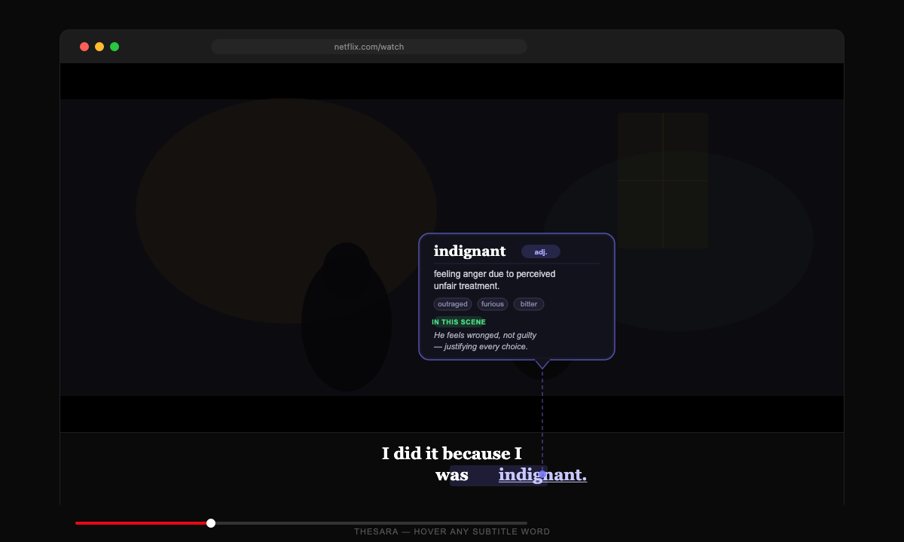
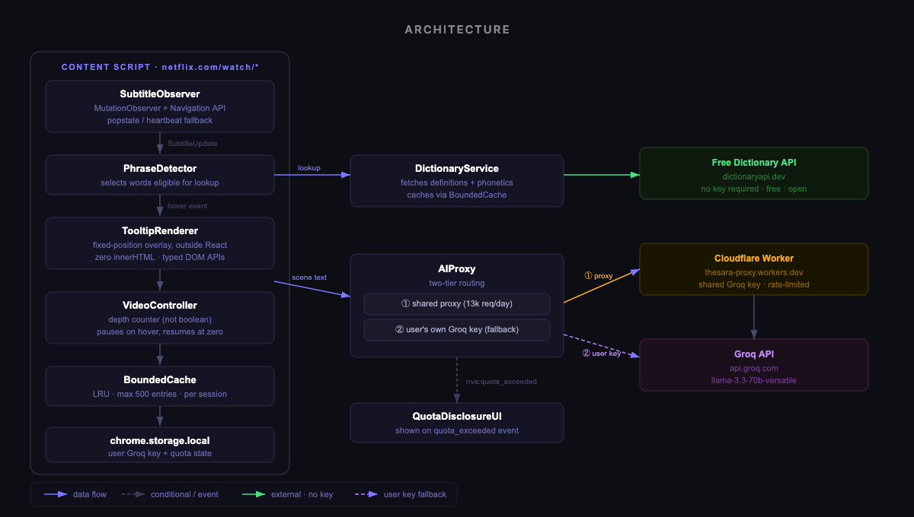

# Thesara

**Hover any word on Netflix subtitles. Get the definition, synonyms, and what it means in this exact scene.**

No account. No fees. One permission.

[](https://chromewebstore.google.com/detail/ajhmpppigjohlajkidehfffodclfdjhl)
[](https://chromewebstore.google.com/detail/ajhmpppigjohlajkidehfffodclfdjhl)
[](LICENSE)
[](https://www.typescriptlang.org)
[](https://developer.chrome.com/docs/extensions/mv3/intro)

---

## Install

<a href="https://chromewebstore.google.com/detail/ajhmpppigjohlajkidehfffodclfdjhl">
  
</a>

---



---

## What it does

Thesara sits quietly on Netflix until you hover a subtitle word. A tooltip appears with:

- **Definition** from the [Free Dictionary API](https://dictionaryapi.dev), no key required
- **Synonyms** shown as pills at a glance
- **Scene context** powered by Groq's `llama-3.3-70b-versatile`: not just what the word means, but what it means *right now* in the story
- **Auto-pause**: the video pauses while the tooltip is open and resumes when you close it

Nothing is stored. Nothing is tracked. The tooltip is gone the moment you move on.

---

## AI context, explained

A Cloudflare Worker holds a shared Groq key, rate-limited to 13,000 requests per day. It costs nothing to use. If the shared quota runs out, Thesara walks you through adding your own free Groq key: full disclosure shown before anything is saved, key stored only in your browser's local extension storage, sent only to Groq.

The extension never sees your watch history, your account, or your IP address.

---

## Architecture



---

## Technical notes

- Built with **TypeScript** and **Vite** (MV3 content script, IIFE output)
- `SubtitleObserver` uses a `MutationObserver` on the Netflix subtitle container, with [Navigation API](https://developer.mozilla.org/en-US/docs/Web/API/Navigation_API) + `popstate` fallback to survive SPA navigation between episodes
- `VideoController` uses a **depth counter**, not a boolean, so rapid hovers cannot leave the video stuck paused
- `BoundedCache` (LRU, max 500 entries) keeps each word fetched once per session
- Zero `innerHTML` anywhere: all DOM construction uses typed element APIs

---

## Build from source

```bash
git clone https://github.com/hitesh-ctrl/thesara.git
cd thesara
npm install
npm run build
```

Then in Chrome: `chrome://extensions` > **Developer mode** > **Load unpacked** > select the `dist/` folder.

```bash
npm run dev      # Watch mode
npm run lint     # ESLint
npm run format   # Prettier
```

---

## Permissions

| Permission | Purpose |
|---|---|
| `storage` | Saves your Groq key and daily quota state locally in your browser |
| `https://www.netflix.com/*` | Content script injection |
| `https://api.dictionaryapi.dev/*` | Dictionary lookups |
| `https://api.groq.com/*` | Direct Groq calls when you supply your own key |
| `https://thesara-proxy.thesara.workers.dev/*` | Shared Cloudflare Worker proxy |

No `tabs`. No `history`. No `webRequest`. No broad host permissions.

---

## Privacy

- No analytics or telemetry of any kind
- Hover events are never logged or stored
- Your Groq key, if added, lives only in `chrome.storage.local` and goes only to Groq
- The shared proxy receives the subtitle text to generate a response; nothing else

Full policy: [hitesh-ctrl.github.io/thesara/privacy.html](https://hitesh-ctrl.github.io/thesara/privacy.html)

---

## License

MIT. See [LICENSE](LICENSE).
